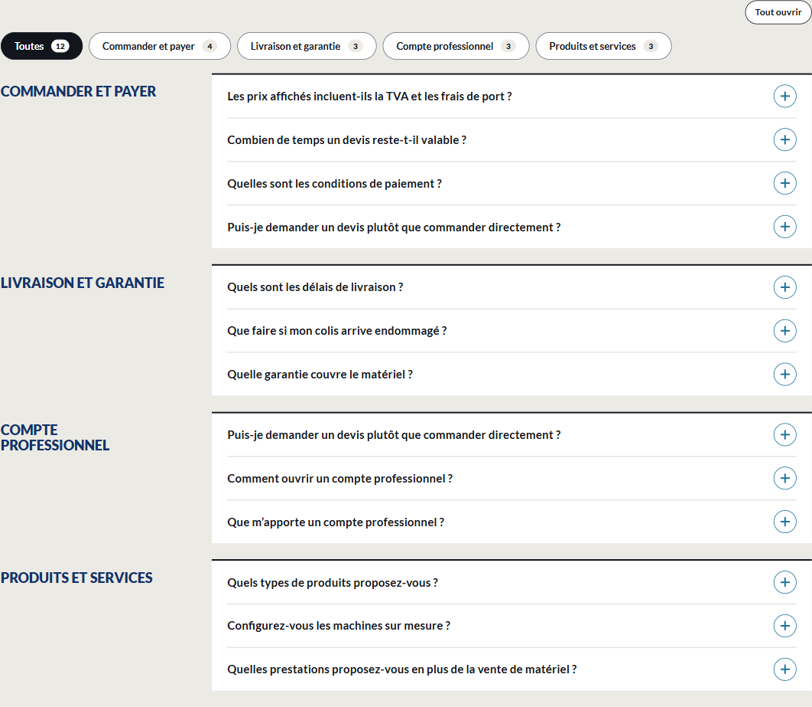
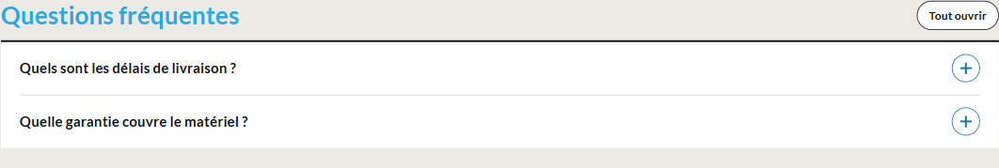

<div align="center">

[English](README.md) · **Français**

# Maxcode FAQ pour Magento 2

**Une seule FAQ pour toute la boutique : groupes et questions par vue de magasin, une page FAQ, un widget à placer dans n'importe quelle page ou bloc CMS, des blocs sur les fiches produit, les catégories et les pages CMS, le balisage FAQPage, et un import depuis Mageprince FAQ et MageWorx FAQ.**


</div>



## Ce que fait le module

Deux modules de FAQ à nourrir et à afficher, c'est ingérable : Maxcode FAQ est **le seul module de FAQ** de la boutique, et il remplace Mageprince FAQ et MageWorx FAQ. Il ne dépend d'aucun autre module Maxcode et d'aucun thème : le balisage est du HTML neutre et accessible (`details` / `summary`), le style tient en quelques variables CSS, et rien n'exige Luma ni Hyvä (testé sous Swissup Breeze).

- **Des groupes et des questions.** Une question a un texte par défaut et, si vous voulez, **un texte par vue de magasin** (question et réponse ensemble) ; elle est visible dans **toutes les vues** ou dans celles que vous cochez, et, si vous le voulez, **seulement pour certains groupes de clients**. Elle appartient à **un ou plusieurs groupes** (« Livraison », « Paiement »...), a un ordre de tri et un statut **actif** ou **brouillon** (un brouillon n'est jamais affiché). Les réponses s'écrivent dans l'éditeur HTML de Magento.
- **Une page FAQ**, à l'adresse que vous voulez, par vue de magasin (`faq`, `aide/faq`...), avec son titre et sa méta-description. Les questions y sont classées par groupe.
- **Un widget « FAQ (Maxcode) »** pour placer des questions où vous voulez : dans une page CMS, un bloc, une page contact, un pied de page. Vous choisissez **un ou plusieurs groupes** (et, si besoin, des numéros de questions), un titre, l'affichage des titres de groupe, le bouton « Tout ouvrir » et un nombre maximal de questions. Il remplace le widget de Mageprince FAQ : l'import peut **réécrire vos anciennes balises** à votre place (voir plus bas).
- **Des blocs sur les fiches produit, les catégories et les pages CMS.** Dans le formulaire d'une question, « Affichée sur » affecte la question à des catégories, des pages CMS et des produits (par leur référence, SKU). Le bloc apparaît en bas du contenu de la page ; chaque emplacement s'active ou se désactive dans les réglages.
- **Un accordéon accessible, sans JavaScript obligatoire, au design soigné.** Chaque question est un `<details>` : elle s'ouvre au clavier et se lit sans script. Mise en page : pour chaque groupe, son titre en majuscules à gauche et la liste à droite (filet épais en haut, filet fin entre les questions, bouton rond « + » qui devient « × » à l'ouverture) ; sur un écran étroit, le titre passe au-dessus. Si le navigateur exécute JavaScript, des **filtres en pastilles avec compteurs** (« Toutes 16 », « Livraison 6 »...) s'ajoutent au-dessus des groupes, ainsi qu'un bouton « Tout ouvrir / Tout fermer ». Une question dont l'adresse `#mcfaq-q12` figure dans le lien s'ouvre d'elle-même.
- **Le balisage FAQPage (JSON-LD)**, activable, écrit une fois par page même si la page porte plusieurs blocs. Il décrit ce qui est affiché ; il ne promet aucun affichage particulier dans les résultats de recherche (Google ne montre plus les résultats enrichis de FAQ que pour certains sites).
- **Des réponses qui ne peuvent jamais exécuter de script.** À l'affichage, chaque réponse passe par une liste blanche : mise en forme simple, liens, images, tableaux ; jamais de script, de formulaire, de gestionnaire d'événement ni d'adresse `javascript:`. Les directives de contenu de Magento sont limitées aux liens vers une catégorie, un produit ou une page CMS et aux adresses `{{media}}` / `{{store}}` : toute autre directive (bloc, variable, configuration) est supprimée.
- **Une administration standard de Magento** : **Contenu > FAQ > Questions** et **Groupes** (grilles filtrables avec actions de masse, formulaires), et les réglages sous **Stores > Configuration > Maxcode > FAQ**. Droits d'accès propres (questions, groupes, réglages).
- **Un import** (`bin/magento maxcode:faq:import`) depuis **Mageprince FAQ** et **MageWorx FAQ**, avec `--dry-run`, relançable sans risque.
- **Traduit** en anglais et en français. **Tests unitaires** inclus.

## Installation

```bash
composer require maxcode/module-faq
bin/magento module:enable Maxcode_Faq
bin/magento setup:upgrade
bin/magento setup:di:compile
bin/magento cache:flush
```

Prérequis : Magento Open Source ou Adobe Commerce 2.4.x, PHP 8.2 ou supérieur. Aucun module tiers n'est nécessaire.

## Utilisation

### Écrire la FAQ

1. **Contenu > FAQ > Groupes** : créez vos groupes (« Livraison », « Paiement »...). Un titre par défaut, et au besoin un titre par vue de magasin.
2. **Contenu > FAQ > Questions** : ajoutez les questions. Remplissez la question et la réponse (texte par défaut), choisissez les groupes, laissez le statut sur **Actif** quand c'est prêt. **Qui la voit** règle les vues de magasin (toutes par défaut) et, au besoin, les groupes de clients. Le bloc **Traductions par vue de magasin** donne un texte propre à une vue (la réponse s'y écrit en HTML).
3. La page FAQ est à l'adresse réglée dans **Stores > Configuration > Maxcode > FAQ > Page FAQ** (`faq` par défaut). Ajoutez-la à votre menu ou à votre pied de page comme n'importe quelle page.

Les mêmes questions peuvent aussi apparaître **sur une fiche produit, une catégorie ou une page CMS** : dans le formulaire de la question, **Affichée sur** la rattache à des catégories, des pages CMS et des produits (par référence). Le bloc ferme alors le contenu de la page, sous le titre réglé dans la configuration :



### Placer des questions dans une page ou un bloc (le widget)

Dans l'éditeur d'une page ou d'un bloc CMS, **Insérer un widget > FAQ (Maxcode)**, puis choisissez les groupes. Ce que le widget écrit :

```
{{widget type="Maxcode\Faq\Block\Faq" group_ids="2,4" title="Livraison" show_group_titles="1" expand_all="0" limit="6"}}
```

| Paramètre | Rôle |
|---|---|
| `group_ids` | les groupes à afficher, séparés par des virgules (leurs questions actives et visibles pour le visiteur) |
| `question_ids` | des numéros de questions en plus, ou à la place des groupes |
| `title` | un titre au-dessus du bloc |
| `show_group_titles` | `1` ou `0` ; vide : comme dans les réglages |
| `group_tabs` | les filtres par groupe : `1`, `0` ou vide (comme dans les réglages) |
| `expand_all` | le bouton « Tout ouvrir » : `1`, `0` ou vide |
| `limit` | nombre maximal de questions |

Plusieurs widgets peuvent se trouver sur la même page : le balisage FAQPage n'est écrit qu'une fois.

### Réglages

**Stores > Configuration > Maxcode > FAQ**, par vue de magasin quand c'est utile.

| Réglage | Rôle |
|---|---|
| Activer la FAQ | désactivée : ni page, ni bloc, ni widget, ni données structurées |
| Adresse de la page | `faq` par défaut ; vide : pas de page FAQ. Si une page CMS utilise la même adresse, la page FAQ la remplace |
| Titre de la page, méta-titre, méta-description | par vue de magasin |
| Titre des blocs | l'intitulé du bloc des fiches produit, catégories et pages CMS |
| Afficher les titres de groupe | sur la page FAQ et dans les widgets (un widget peut en décider autrement) |
| Filtrer par groupe | des pastilles avec compteurs au-dessus des groupes (quand au moins deux groupes ont un titre) ; ajoutées par JavaScript |
| Bouton « Tout ouvrir » | un bouton ajouté par JavaScript |
| Bloc sur les fiches produit, les catégories, les pages CMS | affiche les questions affectées à la page |
| Balisage FAQPage (JSON-LD) | à activer ou non |

### Importer depuis Mageprince FAQ ou MageWorx FAQ

Les deux modules se lisent par leurs tables, en lecture seule : ils n'ont pas besoin d'être activés, il suffit que leurs tables existent (on peut donc désactiver l'ancien module avant d'importer).

```bash
bin/magento maxcode:faq:import --dry-run          # compte et signale, n'écrit rien
bin/magento maxcode:faq:import                    # Mageprince et MageWorx
bin/magento maxcode:faq:import --source=mageprince
bin/magento maxcode:faq:import --convert-widgets  # réécrit aussi le widget Mageprince des pages et blocs CMS
bin/magento cache:flush
```

L'import **est relançable** : une question ou un groupe déjà importé (même origine, même identifiant) est reconnu et laissé tel quel, jamais écrasé ni dupliqué ; ce que vous avez corrigé ensuite reste.

**Mageprince FAQ** (`prince_faqgroup`, `prince_faq`)

- un groupe devient un groupe, une question devient une question (titre, réponse, ordre, statut) ;
- les vues de magasin, les groupes de clients et les groupes sont des listes séparées par des virgules dans Mageprince : elles sont reprises. Une liste qui couvre tous les groupes de clients de ce site devient « tout le monde » ;
- **une question ne s'affiche jamais plus largement que dans la source.** Chez Mageprince, une question n'est vue que dans un groupe actif et si le groupe ET la question sont visibles pour le visiteur : les restrictions du groupe (vues de magasin, groupes de clients) s'ajoutent donc à celles de la question, et un groupe désactivé cache ses questions. Une question visible nulle part (vues de magasin ou groupes de clients absents de ce site, groupes tous désactivés, restrictions qui ne se recoupent pas), ou dont les groupes ont des restrictions différentes que Maxcode ne sait pas combiner, est importée **en brouillon** et signalée ;
- une question sans groupe s'affichait dans tous les groupes chez Mageprince ; elle devient une question sans groupe, affichée à la fin de la page FAQ ;
- l'adresse de la page FAQ de Mageprince (`faqtab/seo/faq_url`) est rappelée à la fin : reprenez-la dans Maxcode FAQ pour garder la même adresse ;
- `--convert-widgets` remplace dans les pages et blocs CMS `{{widget type="Mageprince\Faq\Block\Index\Index" group_id="1,4" ...}}` par le widget Maxcode, avec les numéros de groupes traduits et la même écriture que l'original (guillemets échappés dans un contenu Magezon, par exemple) ; un widget dont un groupe n'a pas été importé reste inchangé et est signalé. Les instances de widget (Contenu > Widgets) et les widgets de MageWorx ne sont pas réécrits : la commande les signale. Avec `--dry-run`, elle liste ce qu'elle réécrirait.

**MageWorx FAQ** (`mageworx_faq_*`)

- un couple question/réponse devient une question ; un bloc « personnalisé » devient un groupe ; un bloc produit, catégorie ou page CMS affecte ses questions aux produits, catégories et pages liés (ces questions ne s'affichent pas sur la page FAQ, sauf si un groupe les contient aussi) ; un bloc « spécial » (panier, caisse...) n'est pas publié sur la page FAQ ; seuls un bloc actif et un élément actif comptent ;
- les textes par vue de magasin sont repris, et une vue sans texte retombe sur la vue par défaut (0) ; les blocs automatiques (`is_auto`) sont ignorés ; les liens vers une page « spéciale » (panier, caisse...) n'ont pas d'équivalent et sont signalés.

Les réponses importées gardent leur HTML. Celles écrites avec Magezon Page Builder sont réduites à leurs textes à l'affichage.

### Ce qui est enregistré, exactement

Les questions, les groupes et leurs liens (vues de magasin, groupes de clients, affectations) dans les tables `maxcode_faq_*`. Aucune donnée client, aucun cookie, aucun appel à un service extérieur : le module n'envoie rien hors de votre serveur.

## Pour les développeurs

| Élément | Rôle |
|---|---|
| `maxcode_faq_group`, `maxcode_faq_group_text` | les groupes et leurs titres par vue de magasin (0 = titre par défaut) |
| `maxcode_faq_question`, `maxcode_faq_question_text` | les questions (`status` : 0 brouillon, 1 actif ; `show_on_page` ; `source` / `source_ref` : origine d'un import) et leurs textes par vue de magasin (0 = texte par défaut ; une ligne par vue remplace question et réponse ensemble) |
| `maxcode_faq_question_store` | les vues de magasin où une question est visible (0 = toutes) |
| `maxcode_faq_question_group` | les groupes d'une question |
| `maxcode_faq_question_customer_group` | les groupes de clients autorisés (aucune ligne = tout le monde) |
| `maxcode_faq_assignment` | les produits, catégories (`category`) et pages CMS (`cms_page`) où une question s'affiche |
| `Model/Question`, `Model/Group`, `Model/ResourceModel/*` | les modèles ; les listes liées ne sont réécrites que si leur clé est présente dans les données du modèle (`texts`, `store_ids`, `group_ids`, `customer_group_ids`, `assignments`) ; étiquette de cache `maxcode_faq`, vidée à chaque enregistrement |
| `Model/Frontend/FaqReader` | la lecture des questions visibles pour un visiteur (actives, vue de magasin, groupe de clients) |
| `Model/Content/HtmlSanitizer`, `AnswerRenderer`, `JsonLd` | nettoyage par liste blanche, directives de contenu autorisées, balisage FAQPage |
| `Block/Faq`, `view/frontend/templates/faq.phtml`, `view/frontend/web/css/faq.css` | le bloc (page, affectations, widget) et son accordéon |
| `Controller/Router`, `Controller/Index/Index` | l'adresse de la page FAQ, réglable par vue de magasin |
| `Model/Import/*`, `Console/Command/ImportCommand` | lecture, conversion pure (testée), écriture et réécriture des widgets |
| `Controller/Adminhtml/*`, `view/adminhtml/ui_component/*`, `Ui/*` | l'administration (composants d'interface standard de Magento) |

Les tables sont prévues pour être lues, sans dépendance de code, par d'autres modules Maxcode (Maxcode AI Assistant les lit pour répondre aux clients et y écrit des brouillons issus des questions des internautes, origine `ai_assistant`) : leurs noms et leurs colonnes sont stables. Qui écrit une question doit écrire au moins sa ligne de vue de magasin (0 = toutes) : une question sans aucune ligne n'est visible nulle part. Les affectations d'un produit, d'une catégorie ou d'une page supprimés restent en base, sans effet.

**Cache de pages.** Enregistrer une question purge la page FAQ, les widgets et les pages auxquelles elle est affectée. Changer un réglage (activer, adresse, balisage) ne vide pas le cache de pages : videz-le. Les blocs ne doivent pas recevoir de `cache_lifetime` (la page FAQ compte sur l'état de la requête pour n'écrire qu'une fois le balisage FAQPage et chaque ancre).

Le style est pensé pour l'accessibilité (WCAG 2.2) : la liste a sa propre surface blanche et les contrôles ont une
bordure franche, le contraste ne dépend donc pas du fond de votre page (textes à 9,8:1 au moins, anneau de focus
visible). Les boutons « + » prennent la couleur de votre thème (la première de `--color-primary`, `--button-primary-bg`,
`--color-brand`, `--primary`, `--link-color` que le thème définit, sinon un bleu), assombrie d'un tiers pour que toute
couleur de thème, même claire, reste lisible ; les couleurs se règlent en quelques lignes :
`.mcfaq { --mcfaq-accent: #8a1f55; --mcfaq-heading: #5c1238; }` (`--mcfaq-accent` : le bouton « + » et le bouton ouvert,
avec un « × » blanc dessus ; `--mcfaq-heading` : titres de groupe ; `--mcfaq-strong` : texte, filtre actif, filets
épais, bouton « Tout ouvrir » ; `--mcfaq-surface` : fond de la liste). Gardez au moins 4,5:1 entre un texte et son fond.

Pour ne restyler que le bouton rond « + » / « × » de chaque question, réglez (tout est facultatif, sur `.mcfaq`) : `--mcfaq-icon-color` (le « + » et son contour ; défaut : l'accent assombri), `--mcfaq-icon-border`, `--mcfaq-icon-bg` (défaut : la surface de la liste), `--mcfaq-icon-hover-bg` (au survol), `--mcfaq-icon-open-bg` (question ouverte) et `--mcfaq-icon-open-color` (le « × » dessus, défaut `--mcfaq-on-accent`, blanc). `--mcfaq-on-strong` est la couleur du texte posé sur `--mcfaq-strong` (filtre actif, « Tout ouvrir » survolé).

## Journal des modifications

Voir [CHANGELOG.md](CHANGELOG.md).

## Licence et support

Gratuit pour un nombre illimité d'installations Magento que vous possédez ou exploitez. Vous recevez le code source complet et pouvez l'adapter à vos besoins ; la redistribution n'est pas autorisée. Voir [LICENSE](LICENSE) (CLUF des modules gratuits, la version française prévaut).

Fourni en l'état, **sans engagement de support ni de mise à jour**. Pour une question ou des prestations payantes : [ebusiness360.fr](https://www.ebusiness360.fr/contact/).
