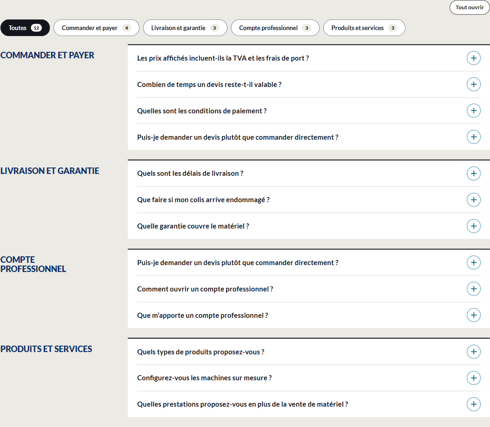
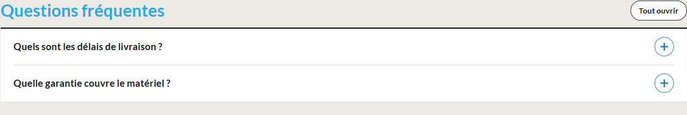

<div align="center">

**English** · [Français](README.fr.md)

# Maxcode FAQ for Magento 2

**One FAQ for the whole store: groups and questions per store view, a FAQ page, a widget you can drop into any CMS page or block, blocks on product, category and CMS pages, FAQPage markup, and an import from Mageprince FAQ and MageWorx FAQ.**


</div>



## What it does

Two FAQ modules to feed and display is unmanageable: Maxcode FAQ is **the only FAQ module** of the store, and it replaces Mageprince FAQ and MageWorx FAQ. It depends on no other Maxcode module and on no theme: the markup is neutral, accessible HTML (`details` / `summary`), the style is a few CSS variables, and nothing requires Luma or Hyvä (tested under Swissup Breeze).

- **Groups and questions.** A question has a default text and, if you want, **one text per store view** (question and answer together); it is visible in **all views** or the ones you tick, and, if you wish, **only for some customer groups**. It belongs to **one or several groups** ("Delivery", "Payment"...), has a sort order and a status, **active** or **draft** (a draft is never shown). Answers are written in Magento's HTML editor.
- **A FAQ page**, at the address you choose, per store view (`faq`, `help/faq`...), with its title and meta description. Questions are listed by group.
- **A "FAQ (Maxcode)" widget** to place questions anywhere: in a CMS page, a block, a contact page, a footer. You choose **one or several groups** (and question numbers if needed), a title, whether group titles are shown, the "Expand all" button and a maximum number of questions. It replaces Mageprince FAQ's widget: the import can **rewrite your old tags** for you (see below).
- **Blocks on product, category and CMS pages.** In a question's form, "Shown on" assigns it to categories, CMS pages and products (by SKU). The block appears at the bottom of the page content; each place is switched on or off in the settings.
- **An accessible accordion, no JavaScript required, with a careful design.** Each question is a `<details>`: it opens from the keyboard and reads without any script. Layout: for each group, its title in capitals on the left and the list on the right (thick rule on top, thin rule between questions, a round "+" button that turns into "×" when open); on a narrow screen the title moves above. When the browser runs JavaScript, **filter pills with counters** ("All 16", "Delivery 6"...) are added above the groups, together with an "Expand all / Collapse all" button. A link ending in `#mcfaq-q12` opens that question by itself.
- **FAQPage markup (JSON-LD)**, switchable, written once per page even when the page carries several blocks. It describes what is displayed; it does not promise any particular display in search results (Google now shows FAQ rich results only for some sites).
- **Answers that can never run a script.** On output every answer goes through an allow-list: simple formatting, links, images, tables; never a script, a form, an event handler or a `javascript:` address. Magento content directives are limited to links to a category, a product or a CMS page and to `{{media}}` / `{{store}}` addresses: any other directive (block, variable, configuration) is removed.
- **A standard Magento admin**: **Content > FAQ > Questions** and **Groups** (filterable grids with mass actions, forms), and the settings under **Stores > Configuration > Maxcode > FAQ**. Own access rights (questions, groups, settings).
- **An import** (`bin/magento maxcode:faq:import`) from **Mageprince FAQ** and **MageWorx FAQ**, with `--dry-run`, safe to run again.
- **Translated** into English and French. **Unit tests** included.

## Installation

```bash
composer require maxcode/module-faq
bin/magento module:enable Maxcode_Faq
bin/magento setup:upgrade
bin/magento setup:di:compile
bin/magento cache:flush
```

Requirements: Magento Open Source or Adobe Commerce 2.4.x, PHP 8.2 or later. No third-party module is needed.

## Usage

### Writing the FAQ

1. **Content > FAQ > Groups**: create your groups ("Delivery", "Payment"...). A default title and, if needed, a title per store view.
2. **Content > FAQ > Questions**: add the questions. Fill in the question and the answer (the default text), choose the groups, leave the status on **Active** when ready. **Who sees it** sets the store views (all by default) and, if needed, the customer groups. The **Translations per store view** block gives a view its own text (the answer is written in HTML there).
3. The FAQ page is at the address set under **Stores > Configuration > Maxcode > FAQ > FAQ page** (`faq` by default). Add it to your menu or footer like any page.

The same questions can also appear **on a product, category or CMS page**: in the question's form, **Shown on** assigns it to categories, CMS pages and products (by SKU). The block then closes the page content, under the heading set in the settings:



### Placing questions in a page or a block (the widget)

In the editor of a CMS page or block, **Insert Widget > FAQ (Maxcode)**, then choose the groups. What the widget writes:

```
{{widget type="Maxcode\Faq\Block\Faq" group_ids="2,4" title="Delivery" show_group_titles="1" expand_all="0" limit="6"}}
```

| Parameter | Role |
|---|---|
| `group_ids` | the groups to show, comma-separated (their active questions that are visible to the visitor) |
| `question_ids` | question numbers in addition to, or instead of, the groups |
| `title` | a heading above the block |
| `show_group_titles` | `1` or `0`; empty: as in the settings |
| `group_tabs` | the group filters: `1`, `0` or empty (as in the settings) |
| `expand_all` | the "Expand all" button: `1`, `0` or empty |
| `limit` | maximum number of questions |

Several widgets can sit on the same page: the FAQPage markup is written only once.

### Settings

**Stores > Configuration > Maxcode > FAQ**, per store view where useful.

| Setting | Role |
|---|---|
| Enable the FAQ | off: no page, no block, no widget, no structured data |
| Page address | `faq` by default; empty: no FAQ page. If a CMS page uses the same address, the FAQ page takes it over |
| Page title, meta title, meta description | per store view |
| Title of the blocks | the heading of the block on product, category and CMS pages |
| Show group titles | on the FAQ page and in widgets (a widget can override it) |
| Filter by group | pills with counters above the groups (when at least two groups have a title); added by JavaScript |
| "Expand all" button | a button added by JavaScript |
| Block on product, category and CMS pages | shows the questions assigned to the page |
| FAQPage markup (JSON-LD) | on or off |

### Importing from Mageprince FAQ or MageWorx FAQ

Both modules are read through their tables, read-only: they do not need to be enabled, their tables only need to exist (so the old module can be disabled before importing).

```bash
bin/magento maxcode:faq:import --dry-run          # counts and reports, writes nothing
bin/magento maxcode:faq:import                    # Mageprince and MageWorx
bin/magento maxcode:faq:import --source=mageprince
bin/magento maxcode:faq:import --convert-widgets  # also rewrites the Mageprince widget in CMS pages and blocks
bin/magento cache:flush
```

The import **is safe to run again**: an already imported question or group (same origin, same identifier) is recognised and left as it is, never overwritten or duplicated; whatever you fixed afterwards stays.

**Mageprince FAQ** (`prince_faqgroup`, `prince_faq`)

- a group becomes a group, a question becomes a question (title, answer, order, status);
- store views, customer groups and groups are comma-separated lists in Mageprince: they are kept. A list covering every customer group of this site becomes "everybody";
- **a question is never shown more widely than in the source.** In Mageprince a question is only seen in an active group, and only if the group AND the question are visible to the visitor: the group's restrictions (store views, customer groups) therefore add to the question's own, and a disabled group hides its questions. A question that is visible nowhere (store views or customer groups missing on this site, every group disabled, restrictions that do not overlap), or whose groups have different restrictions that Maxcode cannot combine, is imported **as a draft** and reported;
- a question without a group was shown in every group by Mageprince; it becomes a question without a group, shown at the end of the FAQ page;
- the address of Mageprince's FAQ page (`faqtab/seo/faq_url`) is recalled at the end: set the same address in Maxcode FAQ to keep it;
- `--convert-widgets` replaces `{{widget type="Mageprince\Faq\Block\Index\Index" group_id="1,4" ...}}` in CMS pages and blocks by the Maxcode widget, with the group numbers translated and the same writing as the original (escaped quotes inside Magezon content, for instance); a widget with a group that was not imported stays unchanged and is reported. Widget instances (Content > Widgets) and MageWorx widgets are not rewritten: the command reports them. With `--dry-run` it lists what it would rewrite.

**MageWorx FAQ** (`mageworx_faq_*`)

- a question/answer pair becomes a question; a "custom" block becomes a group; a product, category or CMS block assigns its questions to the linked products, categories and pages (those questions are not shown on the FAQ page unless a group also contains them); a "special" block (cart, checkout...) is not published on the FAQ page; only an active block and an active item count;
- texts per store view are kept, and a view without a text falls back to the default view (0); automatic blocks (`is_auto`) are ignored; links to a "special" page (cart, checkout...) have no equivalent and are reported.

Imported answers keep their HTML. Those written with Magezon Page Builder are reduced to their texts on output.

### What is recorded, exactly

Questions, groups and their links (store views, customer groups, assignments) in the `maxcode_faq_*` tables. No customer data, no cookie, no call to an outside service: the module sends nothing off your server.

## For developers

| Item | Role |
|---|---|
| `maxcode_faq_group`, `maxcode_faq_group_text` | the groups and their titles per store view (0 = default title) |
| `maxcode_faq_question`, `maxcode_faq_question_text` | the questions (`status`: 0 draft, 1 active; `show_on_page`; `source` / `source_ref`: origin of an import) and their texts per store view (0 = default text; a row for a view replaces question and answer together) |
| `maxcode_faq_question_store` | the store views where a question is visible (0 = all) |
| `maxcode_faq_question_group` | a question's groups |
| `maxcode_faq_question_customer_group` | the customer groups allowed (no row = everybody) |
| `maxcode_faq_assignment` | the products, categories (`category`) and CMS pages (`cms_page`) where a question is shown |
| `Model/Question`, `Model/Group`, `Model/ResourceModel/*` | the models; linked lists are rewritten only when their key is present in the model data (`texts`, `store_ids`, `group_ids`, `customer_group_ids`, `assignments`); cache tag `maxcode_faq`, cleaned on every save |
| `Model/Frontend/FaqReader` | reads the questions visible to a visitor (active, store view, customer group) |
| `Model/Content/HtmlSanitizer`, `AnswerRenderer`, `JsonLd` | allow-list cleaning, allowed content directives, FAQPage markup |
| `Block/Faq`, `view/frontend/templates/faq.phtml`, `view/frontend/web/css/faq.css` | the block (page, assignments, widget) and its accordion |
| `Controller/Router`, `Controller/Index/Index` | the FAQ page address, set per store view |
| `Model/Import/*`, `Console/Command/ImportCommand` | reading, pure (tested) conversion, writing and widget rewriting |
| `Controller/Adminhtml/*`, `view/adminhtml/ui_component/*`, `Ui/*` | the admin (standard Magento UI components) |

The tables are meant to be read, with no code dependency, by other Maxcode modules (Maxcode AI Assistant reads them to answer customers and writes drafts into them from shoppers' questions, origin `ai_assistant`): their names and columns are stable. Whoever writes a question must write at least its store-view row (0 = all): a question with no row at all is visible nowhere. Assignments of a deleted product, category or page stay in the table, without effect.

**Page cache.** Saving a question purges the FAQ page, the widgets and the pages the question is assigned to. Changing a setting (enable, address, markup) does not empty the page cache: flush it. Blocks must not get a `cache_lifetime` (the FAQ page relies on per-request state to write the FAQPage markup and each anchor only once).

The style is built for accessibility (WCAG 2.2): the list has its own white surface and controls have a firm border,
so contrast does not depend on your page background (texts at 9.8:1 or more, visible focus ring). The "+" buttons
pick up your theme's colour (the first of `--color-primary`, `--button-primary-bg`, `--color-brand`, `--primary`, `--link-color` that
the theme defines, else a blue), darkened by a third so any theme colour, even a light one, stays readable; colours are set
in a few lines: `.mcfaq { --mcfaq-accent: #8a1f55; --mcfaq-heading: #5c1238; }` (`--mcfaq-accent`: the "+" button and the
open button, with a white "×" on it; `--mcfaq-heading`: group titles; `--mcfaq-strong`: text, active filter, thick rules, "Expand all" button;
`--mcfaq-surface`: list background). Keep at least 4.5:1 between a text and its background.

## Changelog

See [CHANGELOG.md](CHANGELOG.md).

## License and support

Free for any number of Magento installations that you own or operate. You receive the full source code and may adapt it to your needs; redistribution is not allowed. See [LICENSE](LICENSE) (free-module EULA, the French version prevails).

Provided as is, **without support or update commitment**. For questions and paid services: [ebusiness360.fr](https://www.ebusiness360.fr/contact/).
